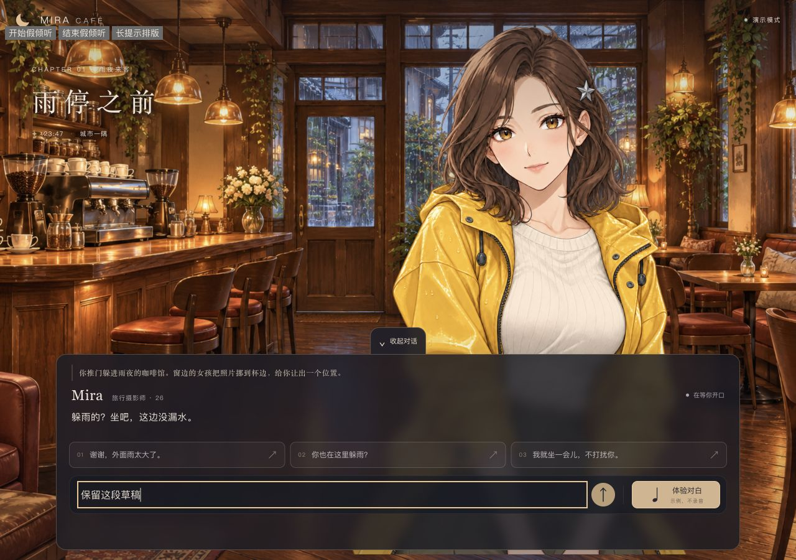
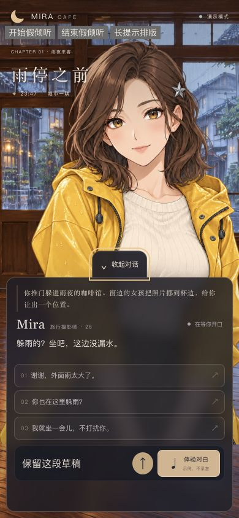
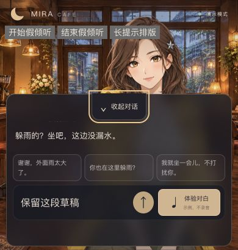
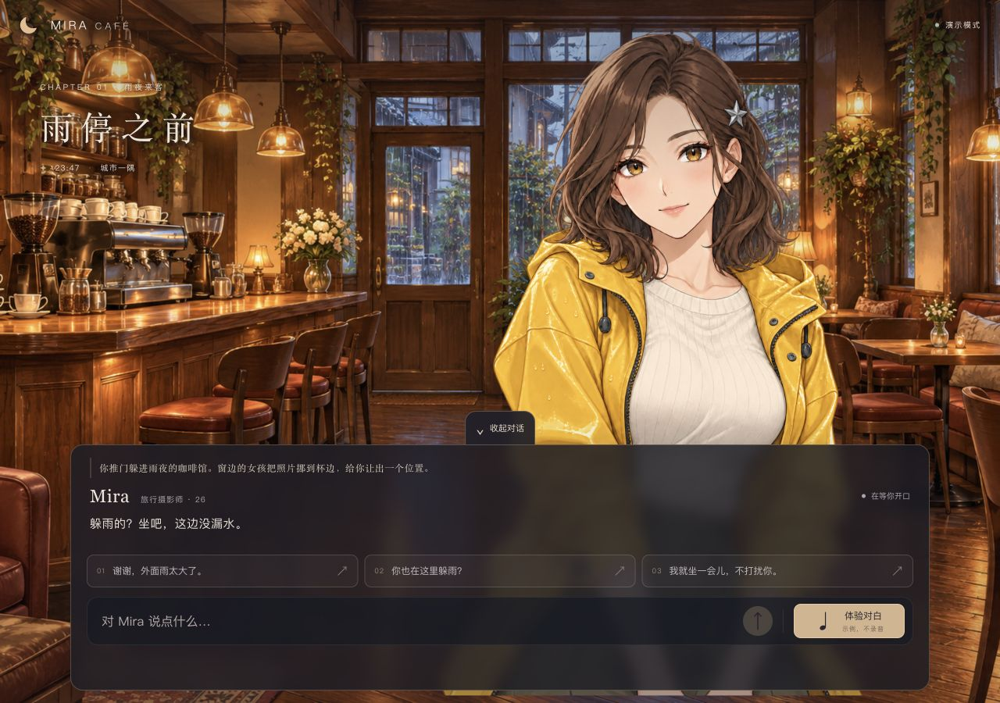

# HUD 折叠验收

用户要求收起对白框以看到更多Mira立绘；随后明确纠正初版右侧悬空按钮，应贴在对白框上沿中间。本页截图已更新为居中版本，旧截图保留在Git历史/旧文件中，不代表当前界面。

## 当前行为

- 默认展开；“收起对话”贴附HUD上沿水平正中，隐藏旁白、对白、三建议和输入后，在底部同一中轴保留“展开对话”。短视口（高度≤560px）将折叠柄嵌入上沿内侧，避免向上挡脸，内容区为按钮预留44px。
- 草稿、最新对白和建议保留，不重新挂载App、不重置剧情。当前播放继续，隐藏期间完成的内容在展开时显示。开关不单独解锁、启动或重播音频，不提交模型请求。
- 折叠取消正在准备/采集/识别的输入和待授权所有权，迟到识别或松手不能提交；展开不自动开启麦克风。
- 原生button、44px点击高度、aria-expanded/aria-controls、Tab焦点、Enter/空格；角色和背景不随折叠移动。

## 实际验证与范围

本轮只改CSS及文档，没有修改状态或音频实现。隔离页运行真实App、假provider/假音频，禁止真实AudioContext及getUserMedia。图中左上角三个控件仅属于验收页，不进入产品。

- 1280×900：HUD中心x=640，展开/收起按钮中心均x=640；展开按钮底边569.805与HUD顶边568.805重叠1px，消除悬空间隙。
- 390×844：HUD中心x=195，展开/收起按钮中心均x=195；展开按钮底边452.609与HUD顶边451.609重叠1px。收起按钮y=788、高44，完全位于视口内；无横向溢出。
- 390×410：按钮嵌入上沿，y=152.906、高44，HUD顶边153.906；对白滚动区从198.906开始，按钮没有覆盖文字。输入区y=303、高58；恢复按钮y=354、高44；脸部、输入和恢复入口可见。
- 桌面折叠前后角色矩形(550.40625,27,576,864)与背景(0,0,1280,900)一致。手机布局保持原尺寸与位置，无人物位移逻辑改动。
- 桌面和手机的Enter/空格、鼠标点击、连续切换后草稿保留，aria-expanded随状态切换；假模型/音频计数均0。
- 完整278项离线测试覆盖原有隐藏期间播放、最新字幕、假录音取消、迟到识别丢弃、待授权失效与展开手势不解锁音频。初版已经实际浏览器检查播放中折叠和假倾听取消；本轮CSS修正没有重复真实服务测试。

尚未进行用户人工验收、真机触摸/软键盘、真实麦克风/扬声器测试。本轮没有付费API调用、录音、放声或线上发布。

## 当前截图

桌面展开，折叠柄贴附上沿正中：

手机展开与收起：

短视口折叠柄位于上沿内侧：

最终检查：npm run check（278项测试及类型/根路径构建）、build:deploy、check:deploy（30项Mock检查）全部通过。3001/3002继续提供当前dist，无需重启未改动的后端。

下图为最终3002产品页面，只加载与折叠，没有发送对话或使用音频设备：

