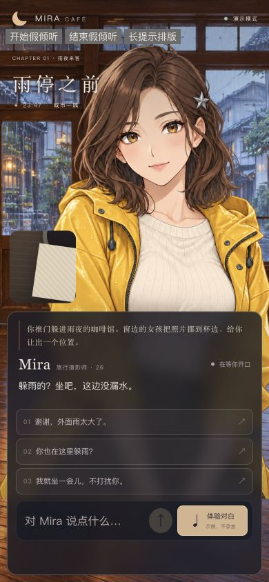
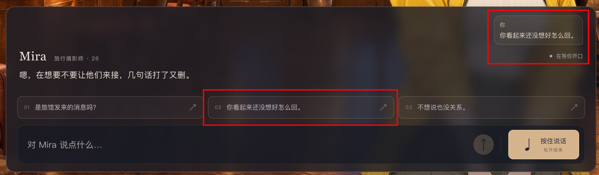
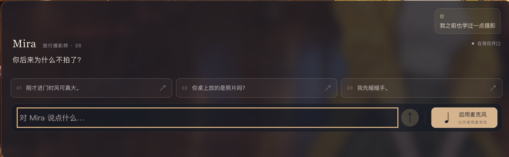
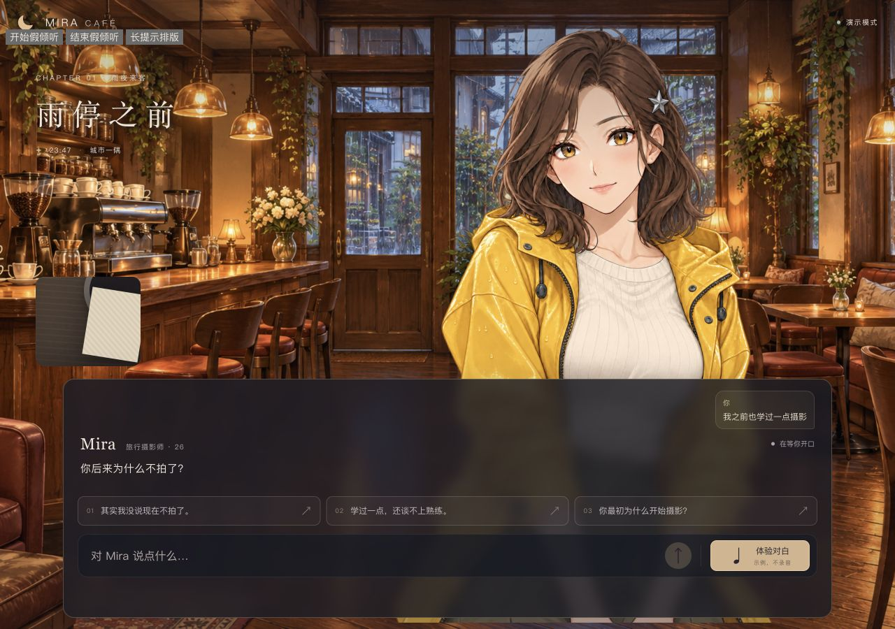
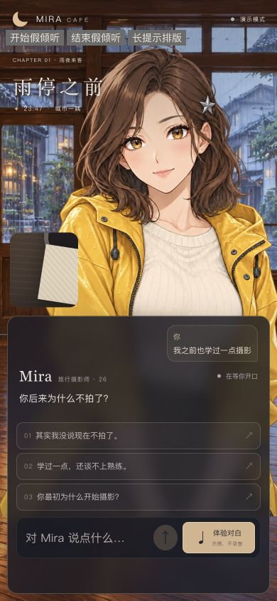
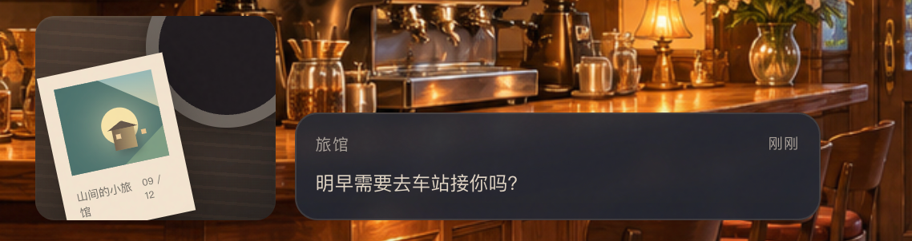
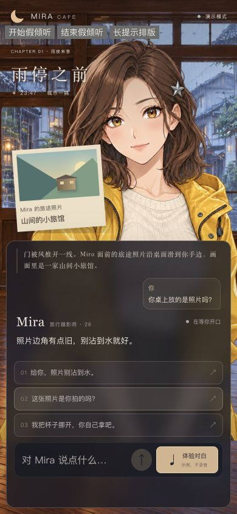
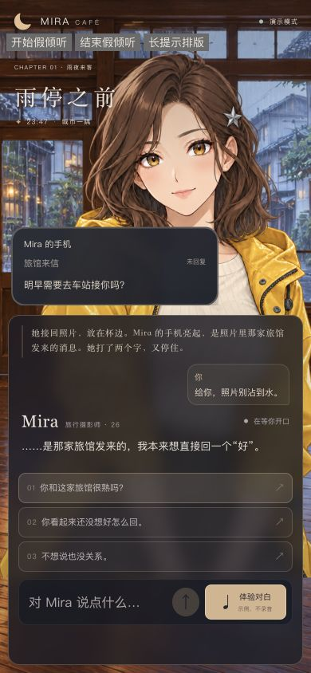
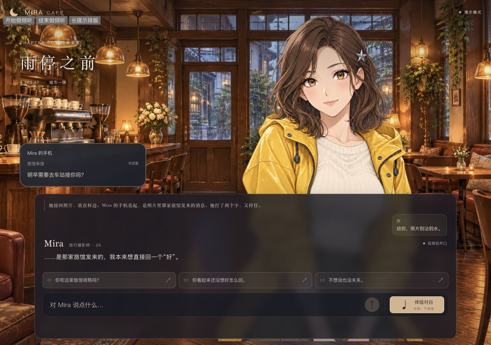

# 用户反馈、AI修复与验证记录

依据上传的《72小时实验：实时互动场景产品》（0912-candidate(1).pdf）：第2页要求麦克风互动与打断；第3页要求失败反馈和恢复；第4页要求注明素材/服务来源且不提交凭据；第5页要求 AI_USAGE 记录AI工作、人工验证及发现并纠正AI结果的实例；第6页要求明确未完成能力、问题及下一步。

本文区分用户实际反馈、AI根据代码作出的判断、假服务验证和仍待完成的真人验收。不把自动测试写成人工验证。两项反馈的日期为2026-10-25；没有保存反馈的原始秒级时间，因此不补造更精确时间。

Git说明：项目此前没有提交。后续分层提交在当前实际时间创建，使用保留的源文件快照与精确索引暂存划分基础版本和修复；不是伪造过去开发过程中的实时提交。

## 问题一：按住体验不能识别讲话

**用户原话：**“按住体验那个按钮有问题，不识别我的语言”。

**发现与复现证据：**用户在本机体验中发现并报告。AI检查到前端 inputMode 固定初始化为mock，后端speechAvailable=true只开放工具内选项，不改变主按钮；release分支实际提交预设文字。脱敏健康状态确认后端DeepSeek/Qwen可用。该直接原因已由代码证实，没有借新增真实请求复现。

**关联问题与确定性：**AI进一步用假设备复现首次权限弹窗失焦/松手取消初始化、连接未就绪时松手丢弃已有有效PCM。这些是确定的代码竞态，但不能断言用户原次反馈也同时经历了它们。

**AI提出并实施的方案：**真实语音配置可用时默认显示“启用麦克风”；权限申请与按住采集分离，允许后明确提示“按住说话”，不自动开始录音。真实服务失败或预算阻塞时不悄悄切模拟。松开先停采集、冲刷尾帧，连接慢则等待后一次提交；初始化超时、短录音、取消和迟到结果都有保护。模拟入口改名“模拟台词／不识别讲话”。

**人工参与与纠错：**原始入口设计由AI实现，缺少真人语音体验验收；用户实际操作后指出问题，纠正了AI把“适配器连通”与“用户能找到真实语音入口”混为一谈的验证缺口。后续代码定位、方案和修复由AI执行。用户尚未明确确认此修复在真实麦克风上验收通过，不作该声称。

**验证结果：**修复时12个测试文件、101项假设备/假连接测试、类型检查和生产构建通过。假测试覆盖真实入口选择、授权拒绝/失焦/迟到、慢连接松手、短录音、初始化超时、Worklet失败清理与取消恢复。只读浏览器确认390px按钮和说明可见、无横向溢出、静音、控制台无错误；Worklet资源HTTP200。

**费用与隐私边界：**这次修复没有实际申请麦克风、录音、播放或新增付费请求；健康计数修复前后均12，本地预算未清零。没有查看、输出或修改.env密钥。既有服务按原配置重启于127.0.0.1:3001。

**缺口与下一步：**真人设备的权限、采集质量、识别准确率和延迟仍由用户接手验证。操作为刷新→启用麦克风并允许→按住说话→出现录音提示后讲话→松开识别。相关细节：[VOICE_INPUT_FIX](VOICE_INPUT_FIX.md)。

## 问题二：角色回复格式异常，前一轮仍能发声

**用户原话：**“测试的时候出现了「角色回复格式异常，请重试。」，前一次对话还能正常发声”。

**发现与证据：**用户在真人体验中报告间歇错误，这是人工发现的问题。原DeepSeek适配器直接JSON.parse后对整个对象做严格Zod校验，所有异常统一转成“角色回复格式异常，请重试”；未检查finish_reason，也没有保存脱敏格式诊断。JSON Object模式保证JSON格式，不保证应用所需字段和枚举。旧prompt允许最多3×180字，但650输出tokens仍可能不足以容纳极端长内容。

**根因确定性：**以上解析与诊断薄弱点已由代码确定。由于当次原始响应没有保存，现有日志也不含finish_reason，无法确认那次究竟是截断、额外字段、null、错误枚举、包装或其他不合规内容。不得把候选原因写成用户当次已证实根因，也没有通过新的付费请求猜测。

**AI方案与修复：**
- 保留非思考模式、JSON Object和650输出token上限，不通过盲目提高额度掩盖问题。prompt改为1–2句、总对白≤120字，枚举直接来自共享schema；可选字段未使用时明确省略。
- 仅对完整已知格式作本地整理：整段JSON代码围栏、单层reply/response/data包装、顶层数组/单段以及完整双编码JSON。未知字段只剔除，不执行。
- 有实际可用对白而演出指令缺失/无效时，保留原对白、全部改为安全中性/idle、移除scene/event，并显示“仅保留可用对白”的降级提示。超长但总量≤540字可完整分段，绝不编造对白补位。
- length截断、异常finish_reason、过滤、无有效文本、损坏JSON、超过展示界限明确失败；不把半截JSON念出来，不自动发第二个收费请求。手动按钮标注“重新请求（会计费）”。
- 新增最近一次格式异常的脱敏诊断：只保存枚举原因、长度、段数、结束状态与数字token用量。没有原始提示词/对白、凭据、Authorization、原始错误、会话标识；.local记录不进Git。

**人工参与与纠错：**此前解析和统一错误文案由AI编写。用户通过实际前后两轮体验指出“前一轮可发声、下一轮报格式”的缺陷，使AI补充了先前只有标准响应fixture的验证范围。修复代码和合成fixture由AI完成；用户没有确认修复后的实际模型响应通过，不能算人工验收完成。

**验证结果：**13个测试文件、144项假HTTP/假设备测试、类型检查、生产构建通过。新增格式测试覆盖完整包装、null/额外字段、缺省/未知枚举、空/超长/截断、异常结束、原型样式字段与未知命令剔除、诊断脱敏、单次请求无自动重试；降级提示在静音字幕中保留。没有新增真实API、录音或播放。

**缺口与下一步：**原次异常无法追溯，只能明确修复可证实的缺陷。用户继续正常使用；若再发生，读取本地脱敏格式诊断即可进一步定位，不要求用户贴密钥、原始私密对话或反复付费试错。本次修复交付时为原3001真实配置、默认静音，预算计数不清零。后续用户已改为回复默认有声并移除体验工具，最新行为见 README；不追改当时验证事实。

参考：[DeepSeek官方请求格式与finish_reason](https://api-docs.deepseek.com/api/create-chat-completion/)。安全白名单仍为guarded/curious/relieved、idle/look-window/offer-photo、rain/warm和reveal-photo；未知指令不执行。

### 问题二后续：第二轮持续出现“未收到有效对白”

**新增人工反馈（2026-10-25）：**用户报告“为什么总是第二次对话的时候，出现了错误提示‘这次没有收到有效对白，未自动重试。’”，并提供截图。用户进一步要求 AI 自己真实连续测试，明确新增有限付费测试授权，不让用户继续承担定位工作；仍未授权录音或出声。

**纠正此前判断与验证缺口：**上一轮解析容错修复未验证真实多轮请求。AI 当时只修解析薄弱点，没有检查历史被序列化为普通句子，不能将那次交付视为已解决多轮根因。此次查看截图像素与既有脱敏诊断后，用未修版本真实连测三轮，在第二轮复现 11 个空白字符、trim 后 0、finish_reason=stop。系统、非思考模式、JSON 模式和650输出上限均存在，因此不是因输出上限截断，也不是播放器或预算错误。

**已定位并修复：**旧引擎每句保存为一个普通 assistant 消息，与当前 JSON 输出契约不一致。现在每轮保存一条 JSON assistant 历史，保留已呈现文本和已校验指令；失败和未完成轮次不进入历史，打断后不把未听到内容当已说过。服务端兼容旧页并合并相邻消息，不从损坏 JSON 摘取碎片。新增最近20次结构诊断，仍不记录原始对白或秘密，不自动重试。

**真实验证：**修前3轮有1次第二轮失败；修后两组各4轮及最终相同输入2轮全部有效；另1次真实语音链路对白有效。共14次DeepSeek，修后11次有效；Qwen两次TTS与一次ASR全部通过，音频不播放，无真实麦克风。169项假服务测试、类型和构建通过。真实验证支持历史格式定位，但没有云端内部证据，不承诺模型永不返回空内容。完整分轮证据、用量与测试限制见 [LIVE_MULTITURN_TEST](LIVE_MULTITURN_TEST.md)。

**人工角色与费用：**用户实际发现问题、提供截图并扩大有限测试授权；定位、修复和程序连测由AI完成，不能称用户已验收本次修复。本次17个服务请求保守估算约¥0.020642，云账单未核对；原累计账本保留到40次/预留¥5.36，不清零、不充值。收费验证结束后停止；用户只需刷新加载新版本，不要求继续替AI复现已定位问题。

### 问题二的最新产品决定：不合格对白受控修正

用户进一步明确“prompt规范，给出完整示例，用Zod校验，不合格重试”。AI没有把它解释为无限重试，而是实现严格模型业务schema、净化字段错误反馈、最多2次额外请求（共3次）；每次独立计入原预算，取消/旧轮次停止，网络/权限/余额不按schema错误重试。空segments/空对白不能算成功，未知动作不执行。此要求覆盖早先不自动收费重试的限制。

最终严格版本新增3轮真实连测，3/3首发有效、0次自动重试；修正成功/耗尽/预算/取消分支由假传输验证，不把假测试写成真实重试恢复。整次调查累计DeepSeek17请求（16有效、1次修前空白失败），TTS2、ASR1，保守估算¥0.024294，非云账单。最终192项假测试、类型、构建通过。用户提出规则与验证要求，AI实施并真实测试，尚不等于用户最终人工验收。详见LIVE_MULTITURN_TEST文末。

## 问题三：尚未对话，切换页签却出现恢复台词

- 发现时间：2026-10-25；用户实际反馈“切换页签后再切换回去，就出现‘你可以继续说，我在这里。’，但实际上我还没开始对话，不要这个页签处理”。
- 确认根因：`visibilitychange` 在隐藏时触发 `bindAudioLifecycle` 的 leave；App 无条件调用 `entry.cancel()` 和 `engine.interrupt()`。即使初始 idle，也会清掉开场、旁白、建议并增加 turnId；App 空字幕 fallback 随后补出这句固定台词。因此不是模型真实返回、不是切回后新发了一次角色回复，而是前端生命周期和展示逻辑共同造成。
- 修复：增加只作用于活跃任务的 `suspend()`，将页签/离页资源清理与用户主动打断区分。初始、完成和错误状态保持原快照；思考/说话/旁白中的任务取消一次，忽略迟到返回，取消未完成剧情道具和建议；已显示对白可保留，但未完成内容不加入历史。删除空字幕的固定恢复台词。录音/识别或待授权仍安全取消，切回不会续录、续播或重试收费。空闲输入、未发送草稿不受影响。
- 验证：新增8项真实业务对象+fake事件/transport/audio测试，覆盖初始反复往返、思考迟到响应、说话取消、完成后建议保持、旁白回滚、错误保留、待授权失效和录音安全停止。21文件238/238、类型检查、构建通过。桌面及390px浏览器用隔离按钮注入隐藏/可见事件，通过实际应用监听器检查开场、三个建议、未发送草稿不变，无控制台error；测试按钮仅存在忽略的 `.local` 预览，未发布。
- 边界：所有检查使用假服务/假音频，无真实API、麦克风或放声；浏览器检查是受控事件注入，不声称逐个真实浏览器/操作系统标签切换已覆盖。用户提供问题和期望，AI定位并实现修复、执行自动化；用户尚未复测验收。本次不调整原53次/¥7.96预算预留。

## 问题四：正常建议按钮被本地预算规则拦截

- 发现：2026-10-25，用户报告点击建议出现“已到合计预算或请求上限”，并明确要求不要限制。
- 确定证据：旧服务端对DeepSeek/ASR/TTS统一执行金额预留和累计次数检查；历史53次/7.96固定预留已使下一次文字请求越过8元停止线。此提示不是云平台余额不足。
- 人工决策：取消产品本地hardblock。AI未修改云账单、充值或删除统计历史。
- 修复：用不阻断provider的RequestAudit替换BudgetGuard；移除旧计费确认/最大次数/价格过期检查；取消与最多3次schema尝试仍有效。统计失败不重置文件、不把未知费用伪装为0。
- 验证：236项本地测试、类型和构建通过，覆盖文字/ASR/TTS超过旧计数、历史保留、损坏/锁冲突、已取消请求及有限格式修正。真人录音与听感未测；实际UI旅程继续单独验收。

## 问题五：实际页面验收暴露的剧情停滞、提前暗示与照片校验冲突

2026-10-25，用户质疑此前体验检查不到位，要求AI自行真实UI验收。AI在5轮实际页面中发现照片未随对白移动、fallback先提未来消息；首次修后又在第二轮复现3次非空stop响应被剧情规则拒绝。用户并未人工验证这次修复，不能写成用户已验收。

AI改为按当前话题和已呈现前置条件补齐外部道具事件，禁止拒绝/歧义/设定玩笑强推；本地建议先检查来信是否呈现；统一照片动作和事件校验，允许回答照片年份而不误记完整隐情。没有绕过Zod、伪造对白或无限重试。现场只有结构诊断，具体拒绝子条件的唯一根因未保留原文证明，两个可确定规则冲突用fixture重现。

最终240项测试/类型/构建通过，真实连续6轮5次首发通过、1轮额外修正通过；照片移动、手机来信及自由新方案/拒绝有效。真实结局未走到，Mock完整拒绝结局与打断/刷新/页签事件注入通过。细节、失败和费用见[真实UI验收](LIVE_UI_ACCEPTANCE.md)。

## 问题六：明确退出后仍不收束

2026-10-25，有限真实补测第5轮显示“其实我也一直在犹豫”，状态ending=null、declined=true。规则只允许而不确保收束。AI补齐委托已呈现且用户退出时的本地C剧本，保留Mira自己做决定、完整呈现回执与取消保护。242项本地测试/类型/构建通过；5轮后停止付费，修后真实结局未验收。用户未人工确认这次修复。详见LIVE_UI_ACCEPTANCE.md。

## 问题七：按住说话时提示把按钮推离指针

2026-10-25，用户指出按住后左下角提示占据新空间，使整个输入区上移。AI在实际App的隔离假输入页面复现：390×844，按钮top从770变743，上移27px；原因是voice-help有消息时才插入，底部HUD随其增高。

最小修复为始终保留两行高的状态区，长文案在区内换行/滚动，按钮宽高固定；隐私提示仍显示，空闲只是保留空间。未改动已存在的pointer capture：按下捕获、pointerup提交一次，pointercancel/lostcapture/按钮blur取消尚未松开的输入，松手后的lostcapture不取消正在识别；窗口失焦仍终止录音/识别。

修后390×844在idle/listening/thinking/error和两行长提示状态，按钮矩形全部为x257/y733/w102/h44；1280×900的idle/listening/长提示均为x1016/y773.203125/w142/h44，状态变化位移0。浏览器使用假输入与假音频，长文案控制只在忽略的.local页面。新增假麦克风测试验证重复取消幂等、已取消捕获停止、迟到结果不提交；已有松手→lostcapture与失焦测试继续通过。真机触摸及真人录音未测试，不能称已通过。

用户提供真实体验问题和预期，AI定位、修复并自动验证；用户尚未复测验收。此修复独立提交，不与五姿态或建议重复问题混合；不发布服务器、不增加付费调用。

### 问题七截图

无保留的修复前截图；27px位移来自当时DOM矩形测量，不补造前图。下图均为修复后390×844的实际App，隔离假输入/假音频；左上角测试按钮仅在忽略的.local验收页存在。空闲与假倾听的主按钮均为x257/y733/w102/h44，不代表真人麦克风验收。

## 问题八：建议原样重复，且与玩家当前话题不衔接

2026-10-25，用户先报告选择第二项后仍出现同一组三建议、剧情似乎没推进，并提出“输入给文本模型的prompt让它感觉剧情没变”的假设；随后提供另一张图，明确指出选项“不对板”。

**用户截图的准确内容：**第一图选中“你看起来还没想好怎么回。”，Mira回应“嗯，在想要不要让他们来接，几句话打了又删。”，建议仍为旅馆来信／没想好怎么回／不想说也没关系。第二图用户说“我之前也学过一点摄影”，Mira却问“你后来为什么不拍了？”，建议为风／桌上的照片／暖手。截图没有地址栏，不能从图证明确切端口；麦克风文案表明真实语音入口，但不能据此确定原次模型响应内容。

**确定证据与未确定部分：**

- AI用实际Suggestions点击、ConversationEngine、HttpTransport、Fastify路由、DeepSeek请求构造器及假外部传输连续复现。两个请求都有最新选择、已呈现assistant JSON历史和phone-message事实；回执没有在这条复现路径丢失。因此不能认定用户原次必然是历史丢失。
- 原本每阶段只有固定回退三句，没有排除刚选过的回应。已展示照片/手机里的“旅馆”又被错误当成未透露委托的秘密，会整组丢弃模型建议，重新安装固定模板。
- 相遇阶段模板与第二张图逐字一致。原回退只看阶段/意图，不看Mira刚问了什么；就算模型返回这组过期模板，也可直接通过。浏览器复核进一步发现smalltalk分支漏筛相遇模板，修复并补入回归。
- 原当次响应未保存，所以无法证明截图中的建议到底由模型原样返回，还是因缺失/不合格触发本地回退。Mira臆断玩家“不拍了”也是图中问题，不能把只说“学过摄影”视作该事实。新增prompt限制已完成，真实模型是否遵守尚未付费复测。

**修复：**模型仍在同次回复生成三条建议。服务端只在对白完整呈现后记住该组三建议；新请求带上这组数据，并针对已出现的来信与当前回应明确尚待讲明的委托承接点。保留已知旅馆的合法选项，单项防剧透，不因一个无效选项抛掉其余有效内容。排除当前/近期已说的句子及上轮原样建议；当Mira向玩家提问，优先用当前问答生成本地安全回退，拒绝固定阶段菜单冒充答案。摄影截图回放提供“其实我没说现在不拍了。”等可选回应。prompt补充不要编造玩家经历、闲聊先接当前话题及完整摄影问答例子。

没有靠轮数推进，不把模糊对白伪记为新事实；如果回放仍只有“正在犹豫”，commission仍未完成。模型之后实际讲明委托并获得呈现回执，才进入下一节点。取消、迟到回执、最多2次格式修正保持原规则；不为建议另外收费重试。

**验证：**27文件270项离线测试、类型检查和构建通过。新增6项真实业务链路假传输回归：连续点击第二项、已知旅馆选项保留、一次格式修正后事实推进、打断后未播事实/建议不进入历史、摄影语境缺失建议与模型返回旧模板两分支。实际App隔离页面在1280×900和390×844回放截图对白，检查新三建议可见，未申请麦克风、未出声、未发真实API。

**人工角色与限制：**用户发现问题、提供截图、提出prompt假设并要求语义衔接；AI负责调查、修复和离线验证。不能写成用户已验收，也不能把假传输成功等同真实DeepSeek剧情进展已改善。任意主题的建议质量仍依赖模型；本次只修已证明的状态/筛选/回退缺陷及prompt约束。服务器未发布新版。

### 问题八截图

修复前：用户原图，已检查不含密钥或无关私人内容，未修改。Library来源分别为libfile_1202fd51f63c819199ee3a2b10dc4473、libfile_4117efa2656081919c6b5f0217814d87。

修复后：实际App桌面与390px截图，假provider回放用户原图里的Mira错误假设，用来验证建议会接当前问答；不是新真实模型返回。左上角仅为隔离测试控制，不发布。图中旧角色问句刻意保留，不能据此声称模型臆断已被真实验收消除。

## 问题九：照片与手机道具不知所指，长期堆叠

2026-10-25，用户给出照片/来信局部截图，询问“这个是什么东西”，随后明确“这两个东西就很迷惑，我也不知道是什么作用”。AI实际查看原图后确认：左边是CSS桌面与杯子背后的倾斜照片，右边是Mira的虚构旅馆来信，不是真实系统通知。

**已证实原因：**原Narrative无条件渲染照片，手机收到消息后也长期保留；桌面杯子底板像另一张黑卡，照片窄栏使“旅馆”和装饰日期断行。手机只有“旅馆／刚刚”，没有清楚的主人标识。旁白与永久叠层无法让用户直接理解两件道具的归属和当前作用。这是AI原呈现设计的问题，不推给用户理解不足。

**最小修复：**引擎增加仅用于当前画面的propFocus，不改变服务端已呈现事实。照片滑动或reveal-photo时只突出照片；来信/草稿/发送事件只突出手机；练习、下一次输入、打断、错误或重置收起特写。已呈现事实仍保留，但旧道具不会在无关对话中复活。照片标明“Mira 的旅途照片／山间的小旅馆”，去掉假桌面大杯子和无意义日期；手机标明“Mira 的手机／旅馆来信／未回复”或草稿、已发送。旁白先交代照片归属与来信关系。无点击功能，因此未制作按钮、链接或假点击效果。明示来信人后，建议也不再重复问“是旅馆发来的消息吗”。

照片仍是原CSS示意图，移动为0.65秒CSS过渡，不是新生成照片或逐帧人物动画；手机消息完全属于剧情，没有真实通信。特写留给玩家阅读，到下一次输入或打断才收起，不靠计时器偷偷推进故事。手机小屏长文本在110px上限内滚动。

**验证：**最终28文件273项离线测试、类型检查、根路径构建、/mira前后端构建及30项部署认证检查通过。新增测试覆盖开场无常驻道具、单一道具、无假按钮、下一轮收起、已知状态保留、取消来信和重置。实际App用隔离Mock/假音频走过相遇→照片→递回→来信→新输入打断；桌面1280×900与390×844检查归属文字、脸/银星发夹、HUD及照片/手机不叠放。390px文档宽与scrollWidth均390，手机高度98.796875px、同屏照片数量0。等待来信建议曾遇一次UI等待超时；读取后确认正常完成、控制台无error/warn，未把超时本身算通过或新增真实调用。

**人工纠错与缺口：**用户提供截图和理解困难，AI修正原设计并执行离线检查；用户尚未确认新效果。没有新增收费API、真实录音、实际放声，也未发布服务器。真人手机、真实模型剧情语义及真实播放节奏仍未验收。

### 问题九截图

修复前用户原图，已检查没有秘密或无关私人内容；来源libfile_9071adafb98481918ceee05755ee1803，未修改。

修复后均为实际App页面，隔离Mock/假音频，没有真实服务调用。测试控制仅在忽略的.local页面，不进入正式产品。

