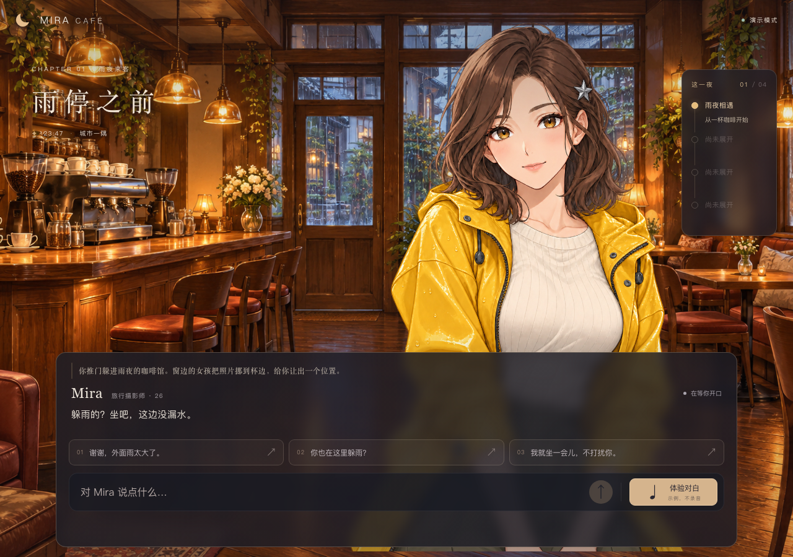
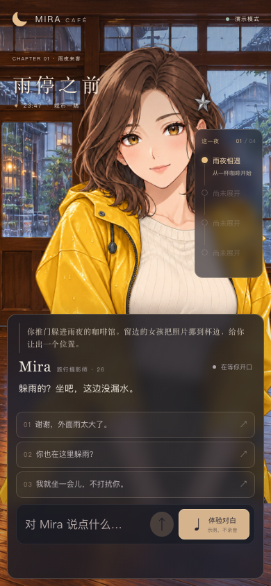
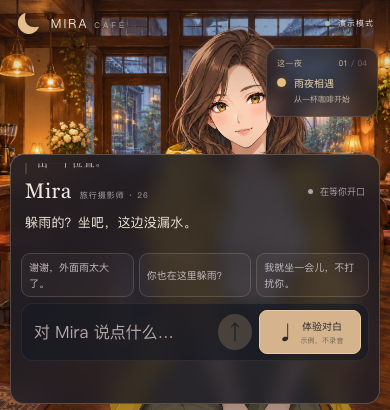
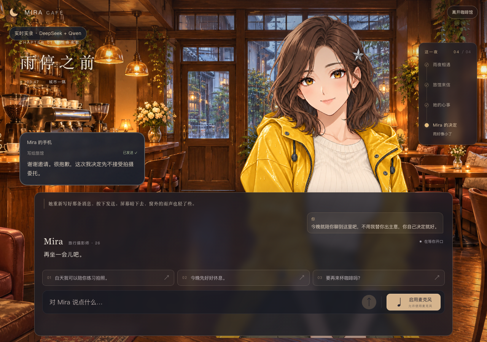

# 最终交付验收 · 2026-10-26

本页为当前版本的统一记录；早期文档中的测试数量、折叠行为和部署状态属于各自历史阶段。自动验证与合成设备不能代替用户的真人体验验收。

## 当前功能与界面

- 用户新增右侧简洁时间线。四节点只读取服务端已呈现事实，当前节点有文字和高亮；未来显示“尚未展开”。短视口仅显示当前节点，不提供跳章或倒退。
- 用户要求删除对白框折叠/展开。已删除 DialoguePanel 状态器、按钮、隐藏属性、折叠专用 CSS 与旧测试；对白框始终显示，后台录音清理仍按原生命周期处理。
- 时间线本身不请求模型、不朗读、不改变剧情。已呈现照片、来信、委托和决定逐步更新；取消或未呈现内容不会成为进度。
- 基础眨眼/嘴型及五套上半身关键帧保留。动作不是连续逐帧动画，也未实现音素口型。

## 离线与浏览器检查

`npm run check`：31 个测试文件、293 项通过，类型检查和根路径生产构建通过。Prettier 3.9.10 已作为锁定开发依赖统一格式化项目，提供 `format` 与 `format:check`。格式化暴露了旧 `@ts-expect-error` 注释的位置问题，改为显式 Node 加密传输模块类型声明，再重新通过类型检查。

`build:deploy` 生成 /mira 前端及 Node 服务端；`check:deploy` 使用临时密码、隔离状态和 Mock 验证 30 项 HTTP/WS 认证、登录退出、资源和子路径。没有加载真实密钥。

实际 App 的无声 Mock 浏览器检查覆盖 1280×900、1920×1080、390×844、390×410：无横向溢出，输入区在视口内，折叠控件数量 0，控制台 pageerror 为 0。手机完整走过相遇→照片→来信→委托→C 结局，时间线分别显示对应已呈现节点。

## 真实剧情检查、失败与修复

所有输入为固定的虚构验收台词，不采集私人对白或麦克风。使用真实 DeepSeek、实际 Fastify、ConversationEngine 与逐句呈现回执，播放为无声完成器；不是扬声器或完整浏览器音频验收。

| 阶段         | DeepSeek 请求 | 路线与结果                                                                  |
| ------------ | ------------- | --------------------------------------------------------------------------- |
| 初查         | 37            | C 5 轮收束；A/B 各 13 轮停在关键事实，未通过                                |
| 第一次修复后 | 32            | A 8 轮后格式修正耗尽；B 13 轮到草稿但未决定，未通过                         |
| 最终版本     | 22            | A、B 各 10 轮完成，包含两次额外格式尝试；两条均实际呈现决定、虚构发送及暖光 |

总计 91 次文字请求，返回 prompt 266138 / completion 6506 tokens。保留各阶段独立的有界记录与原失败记录，未删除标记重跑、重置历史统计或充值；本轮收费测试已停止。费用未查云账单，不把统计加权数当作实扣费用。

源代码可确定的问题包括：一个事实分在两段、beat 只在其中一段时，旧回执只累计带 beat 段；结局发送可能位于第二段决定前；模型自然说法不一定满足完整事实条件，单靠提示词仍可能停滞。初查没有保存完整模型原文，因此不把跨段问题断言为每一次现场停滞的唯一原因。

修复后累计同一回复中真正完成呈现的句子，全部相关对白完成后再确认事实；决定讲完后才执行虚构发送。玩家明确询问且前置条件满足的委托/车票/拍人/回忆/担心/草稿，以及草稿后的明确回信建议，可以使用本地作者对白兜底。兜底属于剧本，不冒充模型原文；闲聊、澄清、拒绝与提前问未来剧情不会强推，未知指令仍严格拒绝。

新增离线回归覆盖两段标记位置、未播段不入历史、两段决定后的发送、自由方案原文保留与不提前结束。句子分割同时修正闭引号孤立成一段的问题，避免只显示/朗读一个闭引号。

此前C的真实收束来自初查；后续按用户要求录制真实API视频时，已在最新5ecd5dd线上浏览器版本实际走通C结局，完整呈现决定、虚构发送与暖光，见下方真实录屏记录。

## 真实语音与设备边界

为检查真实语音通道，隔离服务使用北京 Qwen：总计 27 次 TTS、2 次 ASR，收到 3655680 字节 24k PCM（约 76.16 秒，含随后被打断的音频）。不是 27 次全部完整播放；部分请求按演示操作取消。

Chromium 使用合成 WAV 麦克风设备，走实际 getUserMedia→AudioWorklet→重采样→WebSocket ASR。实际返回“先聊聊咖啡吧。”的重复句子，重复来自循环测试 WAV，不是对真人识别准确率的结论。播放中按住输入后，浏览器状态 speaking=false、listening=true，已调度来源被停止；未使用真人麦克风或扬声器。

两次早期录屏自动脚本分别在等待状态和故障拦截处理处失败，曾改用Mock与系统配音作为交付。用户随后明确否定该选择，要求真实API实录；当前交付已替换，旧版仅保留历史。

## 交付视频：真实线上API实录

当前文件为本机`output/release/mira-demo-live.mp4`，原`output/release/mira-demo.mp4`也已替换为同一真实版本。旧Mock视频移至忽略的`output/release/history/mira-demo-mock-20261026.mp4`，不再作为交付。

实际视频为217.72秒（约3分38秒），1280×900 H.264/AAC。使用正式线上`https://iamm.xyz/mira`的页面和HTTPS/WSS：页面收到10轮DeepSeek成功回复，服务端文字请求新增11次（包括格式修正），Qwen TTS 19次，收到2784000字节24k PCM。没有Mock回复、预录角色语音或系统中文配音，本次为文字输入，未声称演示真人ASR。

画面中的等待、声音、字幕、动作与打断均来自当次应用。仅将原生WebAudio输出导向录制端，按实际调度时刻生成音轨；打断停止4个已调度来源，没有通过假播放时钟加速。只裁去素材加载的开头，没有压缩真实API等待时间。产品原有剧情作者兜底仍保留，调用真实模型不代表每一句剧情事实都是模型原文。

包含相遇、照片、来信、自由闲聊、委托、播放中打断、真实断网错误与手动重试、时间线、C结局和手机布局。断网通过浏览器离线状态制造，没有伪造HTTP回复；恢复后实际重新调用服务。

最初两次真实录制共使用3次DeepSeek和3次TTS，因3秒呈现回执超时失败，保留原证据。取消请求拦截后仍复现，不能归因于Mock或单纯录制工具。修复回执为10秒/至多一次幂等免费重传，并通过新增的5项离线回归后发布5ecd5dd。最终录像中21份呈现回执均HTTP200，最长实测约9.78秒，剧情实际连续推进。失败后仍不放行未知历史的新收费轮次，未自动重试付费对话。

三次录制累计14次页面对话尝试（含一次主动断网失败），实际模型请求14次、TTS 22次，字符上界累计624，未超过初设14次页面请求/48次TTS/3600字符边界。全部收费录制已结束，未清零历史统计，费用未查询云账单。

## 尚需真人操作确认

用户在手机上登录后，只需实际核验：允许麦克风→按住讲一句→松开看到转写→听见字幕对应回复→播放中再按住打断；再检查软键盘、安全区、姿态和最终听感。此处无已完成人工验收的记录，不标通过。

线上开放与实际部署版本以 [部署状态](DEPLOYMENT_STATUS.md) 为准；邀请密码明文只在本机私密访问文件，不在仓库、录屏或聊天中。

## 实际线上发布补充

应用 `d0144bf` 已开放在 https://iamm.xyz/mira ，邀请密码仅在本机私密访问文件。Linux root和受限服务用户各30项Mock编译产物检查通过；真实HTTPS登录/刷新/退出、Cookie属性、受保护素材、nginx WS握手及七项原站基线通过。线上桌面与390px无横向溢出、无pageerror，无折叠控件。

正式线上另外完成1次DeepSeek文字、1次Qwen TTS、1次合成PCM的ASR，识别内容与合成原句归一化后相同；服务器统计从各0增至各1，没有格式重试、真人麦克风或扬声器输出。该检查独立于前述本地91次文字与27次TTS/2次ASR，因此首次发布阶段总计92次DeepSeek、28次TTS、3次ASR；之后用户要求真实录屏，追加的14次DeepSeek、22次TTS单独记录在上方录屏章节。所有有界收费录制现已结束。

本机3001真实配置与3002无收费Mock也已重新加载最终代码。本页其余真人验收边界保留，不因线上连通成功自动标为通过。

## 真实录屏修复的发布补充

应用已从d0144bf更新为5ecd5dd；使用小编译包覆盖新发布目录，复用未改动的Linux锁定依赖与原始图片，旧发布保留。新增前端回执修复，API key、邀请密码、nginx和其他站点未更改。293项测试、类型/根路径构建、/mira构建与本地30项部署检查通过，Linux root和受限mira-cafe用户各30项检查通过。真实录制已验证该版本的多轮呈现回执；原站7项URL摘要回归通过。

随后按用户要求补充剧情自动保存与重置：每次呈现回执成功后，将签名的剧情检查点及对应页面状态写入 localStorage。刷新后恢复最后确认位置、对白、照片/手机、环境、建议和时间线；下一次对话在新会话中恢复已呈现的历史与事实。服务重启或内存过期也可续接，恢复本身不调用模型或重新播放语音。

右上角“重置剧情”需确认，随后清除本机存档，停止当前回复并回到开场；迟到响应不会把旧存档写回来。存储失败会提示且不阻断对话。存档仅当前浏览器、站点和路径；清除浏览器数据会删除，不跨设备同步。

新增7项回归覆盖服务重启后恢复、麦克风取消先于恢复、B结局与自定义方案、未播完内容、重置后迟到回执、损坏/禁用存储、签名及模式/路径校验、稳定本机密钥和收费请求前校验。当前32文件300项、类型和两种构建通过。实际本机浏览器检查1280×900、390×844、320×640、390×410，验证刷新后继续剧情、取消重置、确认重置再刷新；无页面错误或横向溢出。该回归使用隔离Mock服务，不替代真实API交付视频。
