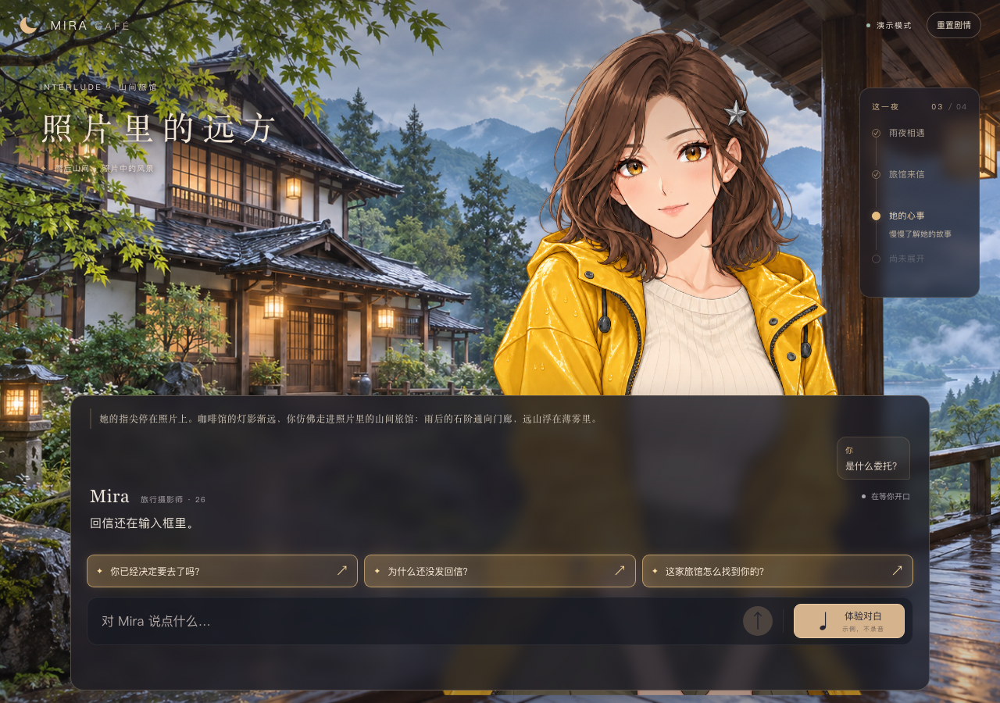
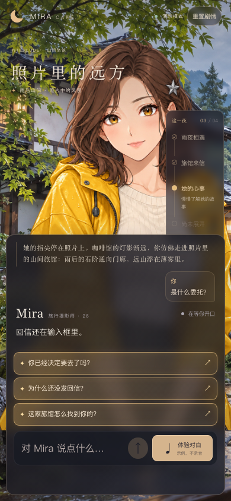
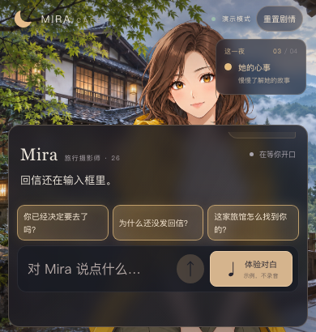
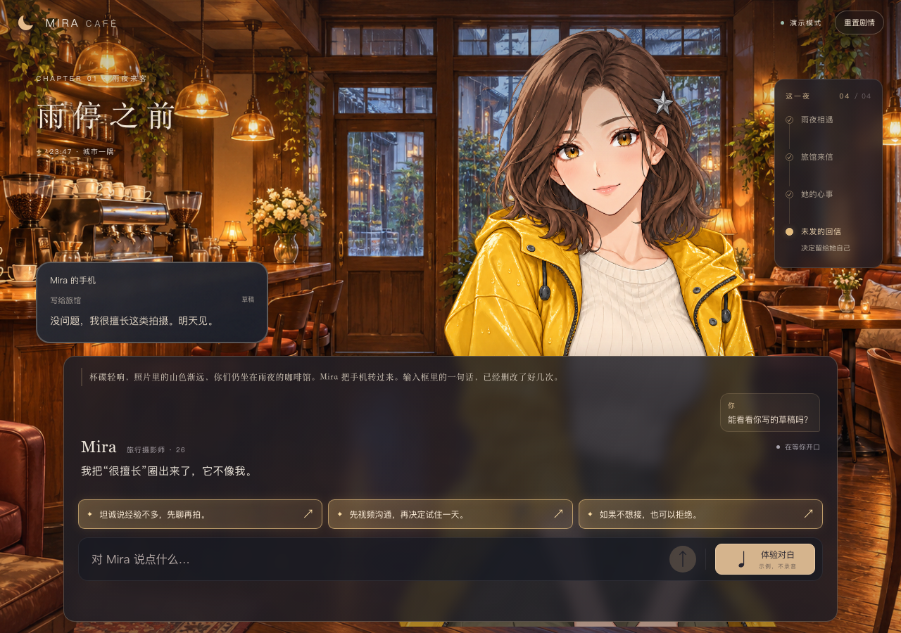
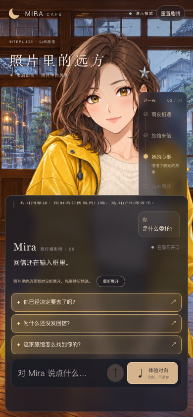

# 照片里的远方 · 剧情场景切换

2026-10-26 已随 `31bdece` 发布线上。用户要求剧情中途至少切换一次实际背景，并允许结合已有剧情扩展。

## 如何体验

从新剧情开始，先回应 Mira、聊到照片并接住手机来信，再问“是什么委托？”。她首次讲起摄影委托时，旁白带你进入照片里的雨后山间旅馆：石阶、门廊、远山与咖啡馆有明显区别。标题切换为“照片里的远方”，地点标为“照片中的风景”。

这段是随讲述展开的想象画面，Mira 和玩家实际仍在咖啡馆，不跳到第二天、不提前接受委托。之后可继续聊车票、拍摄要求、往事和担心；开始练习、看回信草稿或发送回信时，杯碟声与旁白把画面带回咖啡馆。三个结局保持原有含义。

旧存档继续可用，没有位置字段时保持咖啡馆；若已经越过委托节点，可重置剧情体验完整转场。

## 演出与恢复

- 本地导演仅在已呈现旅馆来信后，为首次委托加入 `lodge-view` 旁白；同一事件确认后不重复。它不替代委托对白，旁白完成不等于委托事实已经讲完。
- 地点与雨势/暖光独立。进入旁白时开始约1.4秒淡入，按呈现回执确认位置；途中打断回到上一个完成的地点，迟到加载和旧轮回调不触发转场。已完成后继续输入不会无故回到咖啡馆。
- 照片事件确认后开始预加载旅馆图片。加载中保留咖啡馆，失败提示并提供“重新展开”；不出现空白背景，不额外请求模型。系统减少动态效果设置会关闭转场过渡。
- 地点随已确认剧情保存，刷新不重新播放转场旁白；重置清除位置并回到咖啡馆。签名检查点包含已确认的场景旁白，支持服务重启后续接。

实现入口：`server/stage-director.ts`、`shared/stage.ts`、`src/core/engine.ts`、`src/SceneBackground.tsx`、`src/scene-artwork.ts`。

## 验证范围

35个测试文件、330项测试、TypeScript、根路径及/mira构建通过；编译产物30项隔离Mock认证/HTTP/WS检查通过。新增回归覆盖合法节点、回执前不推进、一次性演出、转场取消、返回取消、重置、刷新/服务重启续接和旧存档兼容。

浏览器使用实际App和Mock后端，假音频禁止实际出声及麦克风。完整走通A结局与明确退出后的C结局，确认委托前不转场、进入途中打断回退、刷新恢复旅馆、看草稿返回咖啡馆、重置再刷新，以及图片失败保留咖啡馆/重试成功。1280×900、390×844、320×640、390×410无横向溢出，输入区在视口内，pageerror为0。证据保存在本机忽略文件`.local/scene-transition-browser.json`；截图见下方。

首轮检查将“如果不想接，也可以拒绝”当作草稿前的明确退出，未产生预期C结局；该句是建议，不等同于玩家退出。改用明确的“我今晚不想出主意，你自己决定吧”后，完整路径通过，没有为测试改写剧情规则。

最终手机补查将加载/失败提示放在对白区，避免遮住脸；图片失败后重试恢复、再明确退出到C结局通过，pageerror为0。补充证据为`.local/scene-background-notice.json`。

本机真实配置3001与免费Mock3002已重新加载新增场景，启动检查没有请求模型。上述首次功能验证没有新增DeepSeek/Qwen调用，不把Mock检查称为真人设备或线上发布验收。

随后按用户要求录制新版真实API视频，约3分03秒，已覆盖两个原交付视频路径。从相遇完整走过10个剧情事实及A结局，咖啡馆→旅馆→咖啡馆两次转场均出现在录像中；真实语音打断、断网手动重试及手机布局也已录入。12份成功页面回复含1次主动打断、11轮完整剧情，服务端新增13次DeepSeek、24次Qwen TTS，29份回执200；无页面/语音错误，ASR0。该录像录制时尚未上线；转场随后已随31bdece发布，详见 [当前交付视频](RELEASE_ACCEPTANCE.md#当前交付视频完整剧情与背景转变)。

## 线上发布

`31bdece` 已部署到 https://iamm.xyz/mira，服务器编译产物检查通过，公网认证后的旅馆背景、JS、CSS和工作线程摘要与本地构建一致。本次发布后仅做三轮真实服务回归，没有重新走完整转场剧情；完整A路线与双向转场由上方真实API录屏覆盖。详见 [部署记录](DEPLOYMENT_STATUS.md#本次更新31bdece)。
