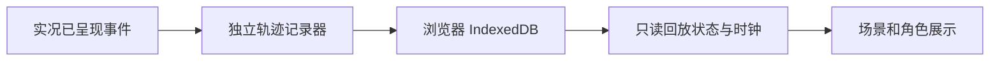

# 剧情轨迹回放方案

状态：讨论稿，尚未实现。当前四节点剧情时间线用于展示进度，语音耗时面板用于阶段观察，都不属于剧情回放。

建议第一版采用本机、只读、默认无声的事件回放：记录一次实际互动中已经呈现的对白、旁白、动作、道具、场景及打断，再按当时顺序重现，不重新请求模型或TTS，也不修改正式剧情存档。

## 第一版体验

1. 提供明确的“开始记录／停止记录”开关，记录只保存在当前浏览器，可以清空。
2. 回复结束后可以打开轨迹列表，查看各轮输入、已展示对白、场景/道具变化、打断及失败节点；未呈现的模型草稿不进入正式剧情回放。
3. 支持播放、暂停、逐步和按节点跳转，显示“无声回放”和当时的相对时间。
4. 提供JSON导出方便问题复现；第一版不提供从任意JSON导入或分享公开链接。
5. 退出回放回到进入前的现场状态，不从历史节点创建新分支，也不将历史回执重新发送服务器。

回放期间禁用现场输入、录音与新请求。首版只在当前回复结束后进入回放，避免同时播放实况和历史；渲染使用独立回放状态，不复用会请求模型或提交回执的ConversationEngine执行路径。

## 记录什么

| 事件 | 记录时机与内容 |
| --- | --- |
| input.accepted | 实际接受的一轮输入、来源及turnId；启用记录后才保存文本 |
| reply.started | 新轮次开始，记录阶段与相对时间，不记录系统提示词和完整模型上下文 |
| subtitle.started | 一句已校验对白真正开始显示时，记录文字、情绪、动作和呈现模式 |
| cue.started | 旁白、道具或场景实际开始呈现，记录白名单参数 |
| presentation.confirmed | 对白/事件完成并收到呈现回执后，保存已确认剧情和页面快照 |
| turn.cancelled | 打断发生时记录取消水位、已呈现位置及实际回退后的画面 |
| turn.failed | 记录受控错误分类与恢复状态，不写原始异常、请求头或凭据 |
| turn.completed | 当前轮演出结束，保留最终可见状态 |

只记录完整模型回复会丢失打断位置，只记录回执会漏掉“已经开始显示、但未完成确认”的一句。因此要区分开始呈现与确认完成：回放可以看见曾显示后被打断的内容，但不会把它错误地计为正式剧情事实。

流式草稿、每个音频块和每帧眨眼不逐条保存，避免记录膨胀。第一版保证对白、场景、动作及取消语义，不承诺像素级或逐帧复现；逐帧证据仍使用录屏。

## 数据与执行

事件包含schemaVersion、sessionId、连续sequence、turnId、相对atMs、type和受限payload。sequence确定顺序，atMs还原等待节奏；保存应用/素材版本，避免后续换素材时把历史效果误认为原效果。

使用浏览器IndexedDB承载有界记录，不新增服务器数据库或Redis。建议先限制最近一次记录、最多50轮或1000条事件；超限停止记录并提示，不影响实况。存储失败也只影响回放，不阻断正常对话。

定期保存确认快照；跳转时取最近的前置快照并按sequence归并后续事件，避免每次从开场演算。原有签名检查点继续服务真实剧情恢复，回放快照不作为服务端可信存档。

## 声音与费用

第一版无声，不重新合成历史语音。重新请求TTS会产生费用，音色、停顿和耗时也可能与原来不同，不能称为原声音回放。

如果后续需要带声音，再单独增加经明确开启的原始输出PCM/音频缓存、存储配额和删除入口，并与事件播放时钟同步；不默认录制本人麦克风原始音频。回放文本可能包含私人内容，导出时需明确说明文件包含对话，不上传服务器。

## 需要验证

- 同一实际记录在重放后，已确认事实、道具和场景与当时一致。
- 一句中途打断后，后续旧字幕、动作和媒体不出现；部分呈现与正式事实保持区分。
- 跳转、暂停和退出不会调用模型、TTS、取消接口或呈现回执。
- 存储失败、超限、刷新与素材版本差异有清楚反馈。
- 手机回放控件可达，关闭后仍能继续原有真实剧情。

建议先完成上述无声事件回放，再根据实际使用决定是否加入原音频，而不是直接做录屏播放器或大规模服务端事件系统。
