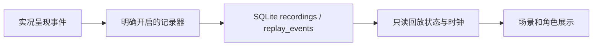

# 剧情轨迹记录与回放

状态：已实现。此前讨论方案按最终选择改为SQLite持久化，与当前匿名浏览器身份关联；本地使用Docker状态卷，服务器继续Node/systemd/nginx部署。

## 使用方式

1. 回复、录音与通话结束后，点击右上角“轨迹”。默认不记录。
2. 点击“开始记录当前剧情”，回到场景继续对话；点击“停录”等待保存结束。
3. 再打开“轨迹”，选择一段记录，可播放、暂停、上一步、下一步或拖动事件位置。
4. 可导出包含对白的JSON，或确认后删除单段记录。删除不重置当前剧情。

最多保留最近5段，每段最多50轮或1000个事件；超过上限停止记录并提示。刷新仍可读取已落库事件。列表读取结束前暂不可开始新记录。网络超时显示中文提示，最多重传一次；401不重试。关闭页面会尽力提交末尾事件，异常退出可能留下“未结束片段”；网络失败停止记录并提示，不阻断当前对话。

回放使用独立只读状态和时钟，复用角色、场景素材展示，不调用ConversationEngine、不重新调用模型、TTS、取消接口或呈现回执。模态窗口阻止现场输入，关闭后回到原来的实时剧情。首版无声，没有缓存原音频或本人麦克风录音，也不从历史节点创建分支。

## 事件与正式事实

| 事件 | 含义 |
| --- | --- |
| recording.started | 开启记录时的当前画面快照 |
| input.accepted / reply.started | 本轮输入被接受、回复开始 |
| subtitle.started / cue.started | 已校验对白或场景、道具开始实际呈现 |
| presentation.confirmed | 服务端确认实际呈现后，更新已确认剧情快照 |
| turn.cancelled | 打断后实际回退的画面 |
| turn.failed / turn.completed | 本轮受控错误或完成状态 |
| story.reset | 当前剧情重置后的画面 |

生成阶段的流式草稿不记录。开始显示但中途打断的一句可以出现在回放里，却不会被当作已确认的正式剧情事实。每个事件保存受限显示快照，sequence决定顺序、atMs保留相对等待；跳转直接读对应快照，不重新演算模型或业务状态。不是逐帧录屏，眨眼等动画使用当前渲染时钟。

## 存储、接口与隔离

`POST /api/replays`创建；`GET /api/replays`列出；`POST /api/replays/:id/events`按连续序号批量写入；`POST /api/replays/:id/stop`停止；`GET/DELETE /api/replays/:id`读取/删除。线上自动带/mira前缀。

所有查询按服务端确定的浏览器身份和模式隔离，写操作检查Origin；共享邀请密码不共享数据。创建UUID与事件序号支持有限幂等重传，乱序、冲突与停止后的新事件返回409，事务失败整批回滚，删除级联清理事件。原始JSON不提供导入与公开分享入口。事件是客户端观察记录，不作为可信服务端剧情或安全审计凭证。

数据库记录含对白，界面在开始及导出前说明用途；不记录系统提示词、模型完整上下文、密钥或原始音频。清除身份Cookie后无法找回这段记录，没有跨设备同步。保存素材版本，历史版本不一致时提示；不承诺旧素材已被归档。

## 验证

10项正式回归覆盖顺序、重复写入、事务、隔离、保留数量与容量、超时限次重试、鉴权不重试、失败清理、真实引擎的打断和迟到回调、只读播放及默认不记录。浏览器在独立Mock Docker环境走完整A结局，录得98个事件/12轮，含双向场景变化、打断、网络失败及手动重试；刷新、导出、删除和另一个浏览器404均通过。回放操作未新增模型、语音、取消或呈现回执请求，当前存档保持一致。

1280×900、390×844、320×640、390×410无横向溢出，桌面与窄屏截图已检查。完整基线41文件406项、类型、两种构建和30项部署检查通过。本次没有调用收费API或使用物理麦克风/扬声器，不把Mock验收算作真人听感或真实服务性能验证。

入口：[引擎事件](../src/core/engine.ts)、[记录器/播放器](../src/core/replay.ts)、[界面](../src/ReplayPanel.tsx)、[服务端仓库](../server/replays.ts)、[迁移](../server/migrations/002-replay.ts)、[回归测试](../tests/replay.test.tsx)。
