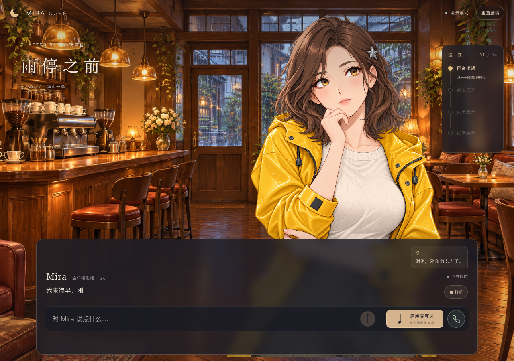
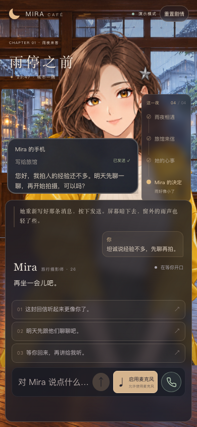

# 流式文字回复（2026-10-26，本地新版）

用户要求优先把文字模型及页面显示改成流式；验收范围以考核题为准，岗位描述作为背景。ComfyUI 本轮只讨论方案，不实现。

## 体验与边界

发送文字、松开按住说话或通话自动提交后，Mira 生成中的对白随真实网络增量显示，状态为“正在回应”。不会等整份 JSON 返回后再用定时器模拟打字。演示模式会模拟增量，右上角继续明确显示模式。

生成中的文字是尚未确认的预览，可能在格式修正或作者规则处理后被最终对白替换。它不执行表情、动作、道具、场景和结局，不启动 TTS，也不写入历史、呈现回执或存档。完整回复通过严格结构及剧情校验后，才按原有演出顺序播放，字幕仍按实际音频开始时刻逐句呈现；等待语音时保留已校验的第一段文字，避免空白。

因此本次实现的是模型到页面的增量文字链路，语音仍采用“完整结构校验后，按句请求并流式播放 TTS”。没有宣称模型尚在生成半句时就开始说话，也没有新增音素或字级语音时间戳对齐。

## 数据流与恢复

- DeepSeek 请求使用 `stream: true` 和 `stream_options.include_usage`，读取 `delta.content`、结束原因与用量；需要正常结束事件和 `[DONE]`，断流不能冒充完整回复。兼容返回普通 JSON 的替身及兼容服务。
- 只从 JSON 的 `segments[0..1].text` 提取预览，处理字段顺序、转义、跨包 Unicode 和未闭合字符串；不会把原始 JSON、动作字段或建议列表直接显示给用户。
- 浏览器以 `Accept: text/event-stream` 请求原有 `POST api/turn`，服务端发送 `start / text / reply / error` 事件，关闭代理缓冲。未使用流式请求头的已有脚本仍收到普通 JSON；认证、子路径和签名存档规则沿用。
- `text` 是当前尝试的完整文字快照；受控格式修正前发空快照，清除上一版预览。每次模型尝试仍独立计数，上限沿用原有三次；网络断流不自动重新请求付费模型。
- 流中错误以终止事件反馈，清除未确认文字并保留手动重试入口。服务端18秒和客户端21秒超时覆盖整个数据流。
- 新输入、开口打断、重置或离页会关闭当前读取并清除预览。服务端轮次水位、客户端取消信号与回调生命周期共同隔离旧内容；已结束轮次的迟到预览不能重新出现。后台继续回复规则保持。
- 只有最终通过校验的回复会建立待呈现记录；实际完成的对白和道具仍通过原有回执推进剧情，刷新只恢复已确认存档。

实现入口：`server/deepseek-stream.ts`、`server/streamed-text.ts`、`shared/sse.ts`、`server/app.ts`、`src/core/transport.ts`、`src/core/engine.ts`、`src/App.tsx`。

上游协议依据 [DeepSeek Chat Completions 文档](https://api-docs.deepseek.com/api/create-chat-completion/)。部署模板已设置 `proxy_buffering off`，流式响应另外返回 `X-Accel-Buffering: no` 与 `Cache-Control: no-cache, no-transform`。

## 验证

- 37个测试文件、361项通过，TypeScript、根路径构建、`/mira`前后端构建及30项隔离部署检查通过。新增11项流式回归，覆盖真实HTTP首块早于完整模型返回、UTF-8字节拆包、JSON转义、修正清屏、断流、超时、取消、轮次不匹配，以及预览不执行动作和不进入历史。
- 浏览器使用实际 App、DeepSeekProvider 的完整 SSE 解析、Fastify 流式接口、同源语音 WebSocket 与原生 PCM 播放。上游文字为本地 SSE 替身，音频为合成 PCM，物理麦克风和扬声器均禁用；没有加载密钥或调用收费 API。
- 实际看到至少三次不同的增量对白，首次文字出现在上游完成、TTS、呈现回执和存档之前。断流显示错误且没有自动请求下一轮；手动重试成功。生成中打断后继续新问题，旧内容不会恢复。
- 连续走通到 A 结局，包含咖啡馆和照片里的旅馆之间的转场、回信与存档；刷新恢复已确认结局，不恢复生成中的预览。1280×900、390×844、320×640、390×410无横向溢出，输入区可达，页面错误0。
- 首次浏览器检查在调整视口后立即读取布局，短视口断言失败；等待视口布局更新后重新测量，四种尺寸通过，没有为此修改产品布局。
- 证据保存在忽略的 `.local/streaming-browser.json`。本次未真实联调 DeepSeek/Qwen 新流式链路、未发布线上，也未重录既有交付视频；合成验证不代表真人听感或真机验收。
- 本机3001真实配置和3002无收费Mock已重载新代码；3001只读取健康状态确认DeepSeek/Qwen配置，3002额外验证实际SSE响应，收到8次增量文字及最终回复。未调用真实模型或语音服务。

