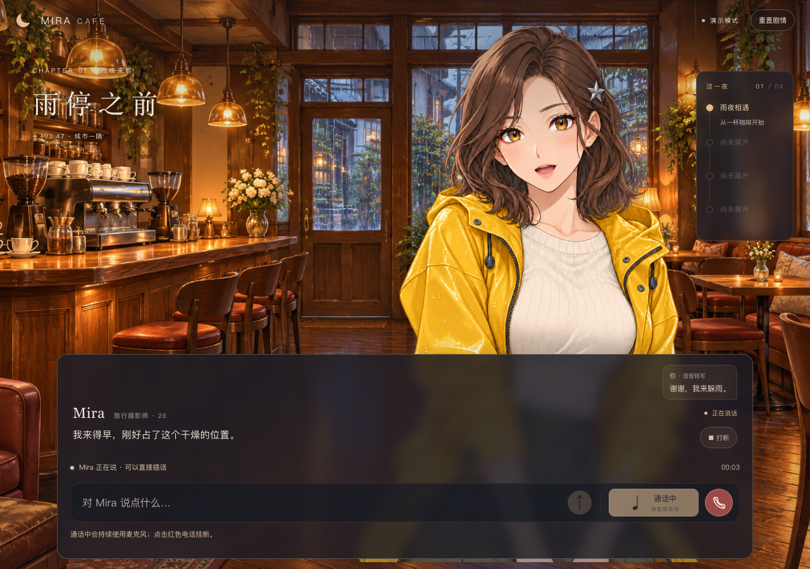
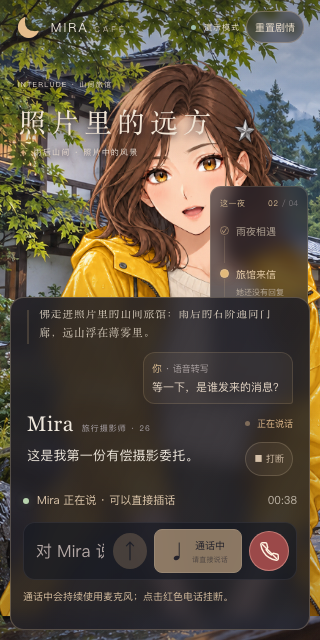

# 实时语音通话（2026-10-26，已发布线上）

用户希望增加电话图标入口，点击后像通话一样连续交谈，并可直接开口打断。当前沿用真实 Qwen ASR → DeepSeek → Qwen 流式 TTS，与文字和按住说话共用同一剧情、上下文、呈现回执与存档；不是另建一套固定对白。此功能已随 `31bdece` 发布线上，2026-10-27新版[交付视频](DEMO_VIDEO.md)已覆盖电话自动识别链路，输入为明确标注的合成测试音频。

## 使用方式

打开[线上入口](https://iamm.xyz/mira)并登录，或使用已启用真实配置的[本机Docker入口](http://127.0.0.1:5173/)，刷新页面，点击输入栏最右侧的电话图标。首次需要允许麦克风；接通后显示麦克风状态、通话时长，电话变红。直接讲话，停顿后自动识别并提交，Mira 用语音回答。她回答时也继续监听，可直接插话；点击红色电话挂断并停止当前回复。本地配置命令见 [DOCKER](DOCKER.md)。

原按住说话入口保留，通话中暂时禁用并显示“通话中／请直接说话”，避免两个采集器争用麦克风。文字和建议仍能发送，会取消尚未完成的旧识别，通话继续。无真实语音配置时电话按钮禁用，悬停说明原因，不用模拟台词冒充语音通话。

## 自动收音与打断

- 使用已有 AudioWorklet、设备采样率到16kHz的 PCM 重采样及同源 WebSocket。显式点击电话才开始采集；加载页面、刷新或恢复剧情不自动开麦。
- 客户端采用轻量能量 VAD：约120ms连续有效音量开始一段，保留约320ms前置缓冲，避免截掉开头；约800ms静音自动提交。安静时只有本地短缓冲，不持续创建云端 ASR 请求。单段在约28.5秒时提交，低于既有30秒上限。
- Mira 回应期间持续监听。有效发声累计约440ms时直接调用原有取消链路，不等识别完成：旧模型请求、TTS、已排期音源、未呈现字幕、动作和道具全部失效。已经完成呈现的剧情事实保留。
- 短于上述阈值的发声先识别；只含“嗯”“对”“好的”等白名单附和时继续当前回复，不发送新的模型请求。短促但有意义的“等等”等内容识别后仍会打断。较长发声已经即时打断，无法在事后识别为附和时撤销；这不是完整语义判断。
- 新发声可取代尚未完成的旧识别。旧识别即使随后返回也不能提交；不将多份迟到识别排队播放。
- 浏览器采集请求回声消除、降噪和自动增益。能量 VAD 不是神经网络语音检测器，噪声、很轻的讲话、长停顿及外放回声仍需真机调节，不能用合成输入证明这些情况已解决。

## 结束、后台与失败

主动挂断、重置、离开页面或退出登录会停止采集，释放全部麦克风轨道，取消识别和当前回复。授权迟到也会立即释放轨道，不能在挂断后偷偷开麦。

切换页签或窗口时只暂停通话收音、取消未完成识别，已经开始的 Mira 回复仍按此前产品要求继续播放并保存；返回后由用户点击电话恢复收音。权限弹窗引发的初始化失焦不会误取消连接。

断网、识别连接失败、超时或麦克风断开时结束通话并显示原因；网络恢复后用户可点击电话重连，沿用原剧情。没有后台自动收费重试。空识别不提交模型，保持监听并提示再说一次。初始化15秒、识别连接8秒、提交后等待12秒均有本地超时保护；原语音代理与模型超时仍有效。

## 与题目可选扩展的对应

本次新增自动检测开口、自动结束一句、自然打断、有限的短附和过滤及通话入口/状态；复用原有按真实音频时钟推进的句级字幕、统一取消和剧情恢复。仍采用题目允许的 STT＋语言模型＋TTS 路线。

文字生成阶段已增量显示，语音仍为句级字幕；尚未新增字级语音时间戳、端到端实时语音模型、自动语音断线重连、首包/分阶段延迟观测页；回声消除只接入浏览器能力，未经过真实扬声器与麦克风验收。不将这个入口称为全部可选扩展已完成。

## 验证记录

- `npm run check`：36个文件、350项测试、类型检查及根路径构建通过。新增测试覆盖双轮连续收音、自动端点、短附和、持续插话、迟到识别、文字替换、授权拒绝/迟到、设备断开、空识别、识别失败和超时。取消测试实际穿过 ConversationEngine，确认旧播放信号失效及迟到动作不能复活。
- `/mira` 前后端生产构建及认证检查单独执行，结果见统一验收。
- 浏览器使用实际 App、AudioWorklet、重采样、WebSocket、PCM 调度器与本机隔离后端；麦克风输入为合成 MediaStream，ASR/TTS 和文字模型均为替身，输出不接物理扬声器。不读取密钥，不产生付费请求。
- 浏览器证据保存在本机忽略文件 `.local/voice-call-browser.json`；包含连续对话推进、短附和不打断、持续插话停止原生音源、挂断/断网/后台释放轨道、权限拒绝、刷新不自动接通，以及390×844、320×640、390×410布局检查。截图如下。
- 最终合成设备路径完成3轮剧情（已确认相遇、照片、来信与委托），共5次页面对话请求、5次ASR（含短附和）、9次假TTS，页面错误0。最后额外的文字输入发生在通话中，用于确认切后台只停止采集、原回复继续；没有将它混为新的语音识别。
- 真人麦克风识别、环境噪声与外放回声、实际听感、手机系统权限与后台策略仍待真实设备确认；合成输入通过不代表人工验收。

实现入口：`src/VoiceCallControl.tsx`、`src/core/voice-call.ts`、`src/core/voice-activity.ts`、`src/App.tsx`。不增加第三方运行时依赖。手动提交 ASR 与浏览器回声约束分别依据 [Qwen ASR 客户端事件](https://help.aliyun.com/en/model-studio/qwen-asr-realtime-client-events) 和 [Media Capture and Streams](https://www.w3.org/TR/mediacapture-streams/)。

## 线上真实语音服务检查

`31bdece` 已上线。浏览器通过合成MediaStream输入固定语音，经AudioWorklet重采样、真实nginx WSS和Qwen ASR，自动提交给DeepSeek，再收到并调度真实Qwen TTS，完成一次电话模式回复并挂断。另以文字输入检查播放中点击打断和后续对话；本次未再次验证真人开口打断。全部检查累计3次DeepSeek、1次ASR、4次TTS，四尺寸和登录/刷新/退出通过。物理麦克风和扬声器未使用，短附和、回声和真实手机仍待验收，详见 [部署记录](DEPLOYMENT_STATUS.md#本次更新31bdece)。
